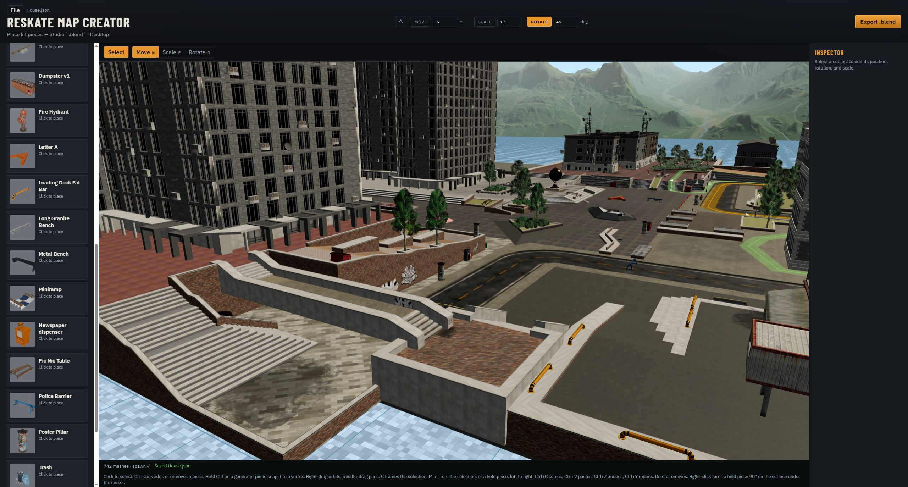
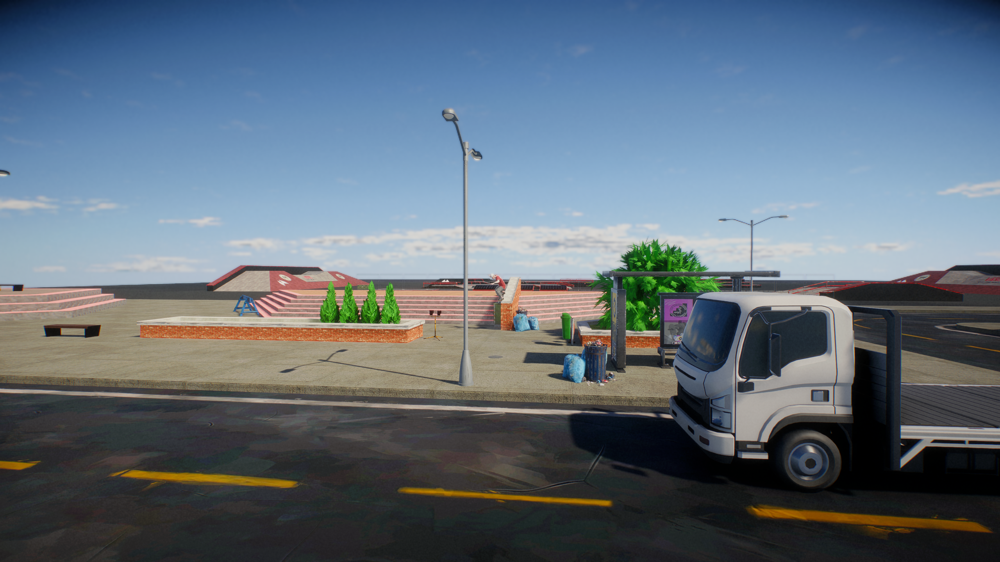

# ReSkate Map Creator





An editor for laying out a skatepark and exporting a `.blend` that ReSkate Studio can load. Place library pieces, draw curbs, rails, platforms, banks, planters, and stairs, set a spawn, add travel points, traffic, and lights, then export.

## Warning

This is vibe-coded. I'm not responsible if it messes up your PC, or if anything happens as a consequence of downloading or using this repo or its releases. By downloading anything from this repo you accept these terms.

## Get the app

Download the latest Windows zip from the [releases page](https://github.com/jonigiuro/ReSkate-Map-Creator/releases). Unzip it and run `ReSkate Map Creator.exe`. The `Objects` folder next to the exe is the library. `public/img/textures` and `public/img/private-textures` sit next to it too. The editor and the export both read those folders, including texture sets you add after installing.

The download is a normal folder. The exe is unsigned, so Avast and other antivirus tools may warn.

Blender has to be installed on your computer. The first time export cannot find it, the editor asks you to pick `blender.exe` and remembers that path. ReSkate Studio is separate. Open the exported `.blend` in Studio.

## Features

- **Library.** Folders in `Objects` become categories. The library reads `.blend`, `.fbx`, and `.obj`, and refreshes when a file is added or saved. A piece follows the cursor and stands on the surface under it, including walls and slopes.
- **Generators.** Draw curbs, rails, platforms, banks, planters, and stairs on the map, then drag their pins. A `.blend` in `Objects/Generators` becomes its own kit run.
- **Interactive.** Bus stops and fast-travel points, with the facing the game reads and a pause-map name.
- **Traffic.** Vehicle lanes, bus lanes, and pedestrian routes, including loops, joins, width, weight, speed class, and stairs.
- **Lights.** Point, spot, and area lights, with color, energy, exposure, range, shadow, and time of day. A prop in a folder named Lights can carry its own lamp. That lamp is on while you place the piece and while it is selected.
- **Spawn.** Every map has one spawn. The figure is where the skater starts, and the arrow is where they head.
- **Selection.** Click to select one piece. Ctrl-click adds or removes pieces. Move, rotate, and scale a group around the center of the selection.
- **Transform.** Move, rotate, and scale with the gizmo or by typing numbers. Snap each one to a step. Hold Control while placing or dragging a generator pin to snap it to a nearby vertex. Mirror a piece left to right.
- **Materials.** Give each material slot a texture and a contact sound, or keep what the file already has. Rescan picks up new texture folders. A mesh with its own textures beside the file keeps those.
- **Collision and the pause map.** Each mesh can use a triangle mesh, a hull, or no collision, and can be hidden from the pause map.
- **Camera.** Orbit, pan, zoom, and frame the selection.
- **Undo.** One hundred steps. Undo restores the map, the selection, and the pins of a generator you are still drawing.
- **Copy and paste.** Copy any selection except the spawn. Each paste lands one metre further along X.
- **Save and open.** A map is a `.json` file. Opening a map locks the editor and shows progress while its models load.
- **Export.** Builds the `.blend` through Blender. Optimize for Studio joins copies of the same piece inside each chunk. The editor stays locked until export finishes.
- **Your own pieces.** Drop models in `Objects`. `Objects/Private` stays on your machine and is left out of the public download.

## How to use the editor

### Camera

Right-drag orbits. Middle-drag pans. The mouse wheel zooms. Press `C` to frame the selection. With several pieces selected, `C` frames all of them.

### Placing a piece

The left bar is the library. Open a category, click a piece, and it follows the cursor. It stands on the surface under the cursor. Right-click turns it 90° on that surface. `M` mirrors the held mesh left to right. Click the map to place it. Click the map again to place another. Click the same piece in the library, or press Escape, to go back to selecting.

Move snap in the top bar locks X and Z to the world grid while you place or drag. The step is in metres. It starts at 1 m and is off until you turn it on.

### Select, move, rotate, and scale

Click an object to select it. The buttons above the view are Select, Move (`W`), Scale (`E`), and Rotate (`R`). The inspector on the right shows the name, position, rotation, and scale, and you can type those numbers in.

Scale changes meshes. Spawn, lights, travel points, and traffic routes move and rotate. Their gizmo stays in move mode when Scale is on.

The spawn stays in the map. Move it when you want the skater to start somewhere else. Delete and copy leave the spawn where it is.

Click empty ground to clear the selection.

### Several pieces at once

Hold Ctrl and click a piece to add it to the selection, or to remove it if it is already selected. A plain click selects only that piece. Cmd-click does the same on a Mac.

The inspector shows how many pieces are selected. Move, rotate, and scale apply to all of them, around the center of their combined bounds. Delete, mirror, copy, paste, and `C` use the whole selection.

Generator pins hide while more than one piece is selected. Select a single piece to drag its pins.

### Snapping

The top bar has Move, Scale, and Rotate. Turn one on and set the step.

| Snap | Starts at | Applies while you |
|---|---|---|
| Move | 1 m | Place or drag. Locks X and Z to the world grid. |
| Scale | 1.1 | Scale. |
| Rotate | 45° | Rotate. |

Hold the Control key to snap a generator pin to a nearby vertex. It works while you are dropping a new pin and while you drag an existing one. The pin catches the vertex closest to the cursor. A marker in the top bar lights up while a vertex has it. Drag a single axis arrow and only that axis snaps, so the other two stay where they are. Let go of Control and the pin follows the surface again.

### Copy and paste

`Ctrl+C` copies every selected object except the spawn. `Ctrl+V` pastes them, selects the new copies, and returns to Select. The first paste sits 1 m further along X. The next paste sits 2 m further, then 3 m, and so on, so the copies do not stack.

Copying one piece reports that piece's name. Copying several reports how many.

### Undo and redo

`Ctrl+Z` undoes. `Ctrl+Y` redoes. The editor keeps the last 100 edits. An edit is a place, a move, a drawn pin, a material change, a delete, a paste, or a mirror. Undo also puts the selection back, and it restores the pins if you were still drawing a generator. A drag with the gizmo is one undo step, not one step per mouse move.

Undo and redo still work while a number field is focused. The other shortcuts wait until you leave the field.

### Generators

Open **Generators** in the library. These are drawn on the map. Escape leaves the tool and drops an unfinished stroke. After you finish a shape, select it and drag the spheres. The inspector can give each material slot its own texture.

- **Curbs.** Click to drop a pin. The next click builds a 0.5 m wide curb, and another click turns the corner on the same mesh. The top 10 cm is concrete, with the metal edge and wax. The rest is bricks. Drag a sphere sideways to move that pin. Drag it up or down to set that end's top or base.
- **Rails.** The same kind of drawing: a 5 cm rail on 0.5 m posts. The top sphere sets the rail. The bottom sphere sets the foot of the post.
- **Platforms.** Click to drop a corner. The third click builds the pad, and another click adds a corner. The pad is 0.5 m tall and the top stays flat. Drag a corner sideways to reshape the outline. Drag any corner up or down and the whole top moves with it.
- **Banks.** Click the foot of the tall side. The next click builds the bank, and another click extends it. It starts 2 m wide and 0.6 m tall, and the slope runs down to the outer edge. A gold pin moves that station, top and outer edge together. An orange pin moves only that top corner. A teal pin moves only that outer corner. **Closed** joins the run into a loop, which needs three pins. **Reverse** flips which side the slope runs to. A bank saved the older way still has eight corners, and each one moves on its own.
- **Planters.** Click to drop a corner. The third click builds the planter, and another click adds a corner. You get a brick box, about 0.55 m tall, with a granite rim and grass inside. Drag a sphere sideways to reshape the outline. Drag it up or down to set that corner's rim or base, and the other corners stay put. Each corner of the curb is a flat square as wide as the curb. The lip between two corners is one straight slope.
- **Stairs.** Click the foot of the tall side. The next click starts the flight, and another click adds a section. The steps rise on the pins and run down toward the outer edge, so a pin on the bottom of a platform puts the tall side against that wall. A new flight has 4 steps, runs 2 m, and is 0.6 m tall. The inspector sets the step count from 1 to 40. Drag a path pin to move the foot of the tall side. Drag any top pin and the whole flight changes height. Drag any side pin and the steps run further out. **Closed** joins the run into a loop, which needs three pins. **Reverse** flips which way the steps run. The steps and the tread are separate materials. The original stair sound is concrete.
- **Kits.** A `.blend` in `Objects/Generators` shows up here as its own tool. Click to extend the run, and click off the line to turn the corner. Straight pieces stretch so they meet. Corners slant the faces that meet.

### Interactive

**Bus Stop** and **Fast Travel Point** stand on the ground. Right-click turns them 90°.

The wire preview matches what the game reads. On a bus stop, the arrow is the shelter's open front and players arrive at the cross. On a fast-travel point, the arrow is the way players face when they arrive, and they arrive at the cross. The inspector name is the pause-map label, about 35 characters. The shelter checkbox turns one into the other.

### Traffic

Open **Traffic**. **Vehicle Lane** is cars, **Bus Lane** is buses, and **Pedestrian Route** is people. Click along the ground to drop pins. The route appears on the second click. The next point closes it back to the start, so nobody stops at the end. The arrow is the direction. Cars and buses are one way. Pedestrians walk both ways unless you uncheck **Both directions**.

Select a route to change its width (3.5 m for cars and buses, 2 m for people), how often the game samples it, and its weight. Cars and buses also have a speed class from 1 to 9. A pedestrian route can be marked **Stairs**. **Reverse direction** flips the point order. Uncheck **Closed loop** when the route should join another of the same type where their points meet. A loop needs three points. Drag a sphere to move that point.

### Lights

Open **Lights**. **Point Light** shines every way. **Spot Light** is a cone. **Area Light** is a panel, either soft or throwing a cone. Click the map. The light sits 4 m off that face and aims back at it. Right-click turns it 90° before you place it.

Select a light to set its color, energy, exposure, range, and shadow. A spot has a cone angle and edge softness. An area light has a shape and a size. Choose which times of day it is on: morning, noon, afternoon, evening, night, weather day, and weather night. Clear every time and the game leaves it out. The sun and sky stay on the game's own time of day. These are direct lights.

A `.blend` in a folder named Lights can carry its own lamp. Name an empty `Direction`, and parent a point, spot, or area lamp under it. Placing that piece keeps the mesh. The lamp type comes from the file. Color, energy, range, and the other lamp settings are the ones in the inspector. The lamp is on while you place the piece and while that piece is selected. **X** pitches that empty so the lamp looks up and down, from -360 to 360 degrees. The housing stays put.

### Spawn

Every map has one spawn. The figure is 1.7 m tall, and the arrow is where the skater heads. Export writes an empty named `spawn`.

### Materials

Select a curb, rail, platform, bank, planter, stairs, or a library piece that uses the shared texture list. Each slot has a texture and a contact sound. Stairs have a slot for the steps and a slot for the tread. **Original** keeps the texture and sound already on that material. On stairs, that sound is concrete. Another choice changes this copy only. **Rescan textures** picks up new texture folders, including ones you drop next to the exe, and reports how many sets it found.

A mesh with its own textures beside the file keeps those. Export copies them with the object.

### Collision

On a generated mesh, or a placeholder that has no library file, the inspector has a collision mode: `triangle_mesh`, `hull`, or `none`. **Hide from pause map** leaves that mesh off the pause map. Export puts these meshes in a collection named `Map`.

### Save and open

**File** holds New, Open (`Ctrl+O`), Save (`Ctrl+S`), and Save As. A scene is a `.json` file, so you can keep working on it later. The file name shows next to File after the first save. Save writes that file again. Save As asks for a new path.

Opening a map that uses library models locks the editor. A popup reads **Opening map** and counts the models as they load. The window accepts input again when they are ready. A map with no library models opens immediately.

New starts a fresh map with a spawn.

### Export

**Export .blend** asks Blender to build the map. The editor locks, with a popup, until Blender finishes. On the desktop app you pick where the `.blend` goes. In the browser the file downloads.

Leave **Optimize for Studio** on unless you need every object written on its own. Optimization joins copies of the same piece inside each chunk and shares duplicate materials, which keeps Studio's build shorter. The chunk size is in metres and starts at 20. It has to be greater than 0. Turn optimization off and each object is written on its own.

Open the `.blend` in ReSkate Studio after that.

From a terminal, with the repo checked out:

```bash
npm run export:blend -- path/to/scene.json path/to/out.blend
```

## Hotkeys

These work when you are not typing in a field, except undo, redo, and Escape, which also work from a field. On a Mac, Cmd stands in for Ctrl on the shortcuts marked Ctrl.

| Input | Action |
|---|---|
| Left click | Select one object, or place the held piece. |
| Ctrl-click | Add or remove a piece from the selection. |
| Hold Control on a generator pin | Snap that pin to a nearby vertex. An axis arrow snaps only that axis. |
| Click empty ground | Clear the selection. |
| Right-drag | Orbit. |
| Middle-drag | Pan. |
| Mouse wheel | Zoom. |
| Right-click | Turn a held piece 90° on the surface under the cursor. |
| `W` | Move. |
| `E` | Scale. |
| `R` | Rotate. |
| `C` | Frame the selection. |
| `M` | Mirror the selection, or a held mesh, left to right. |
| `Delete` | Remove the selection. The spawn stays. |
| `Escape` | Leave the placement tool, drop the pins you are drawing, or close the export dialog. |
| `Ctrl+C` | Copy the selection. The spawn is skipped. |
| `Ctrl+V` | Paste. Each paste steps 1 m further along X. |
| `Ctrl+Z` | Undo. |
| `Ctrl+Y` | Redo. |
| `Ctrl+S` | Save. |
| `Ctrl+O` | Open. |

## Adding your own objects

Put them in the `Objects` folder next to the exe. The folders become the categories in the library.

The library reads `.blend`, `.fbx`, and `.obj`. Use a `.blend` when the object was made with the ReSkate addon: that file keeps the materials, textures, collision, and grind splines. An `.fbx` or `.obj` with the same name as a `.blend` in the same folder is treated as the same object, and the `.blend` is the one that shows up.

```text
Objects/New York/Stairs/Single stair/Single stair.blend
```

That piece is under New York → Stairs, named Single stair. Look in `Objects/Blueprints` for the same kind of layout.

Several models can share one folder and one texture folder, so you don't have to copy the textures for every file:

```text
Objects/Props/signs/stop.blend
Objects/Props/signs/yield.blend
Objects/Props/signs/textures/
```

Each file is its own piece, and `signs` is the category. A folder whose name contains "texture", or image files sitting next to the model, counts as that piece's own textures.

Model with the origin on the pivot, Z up, in metres. The library refreshes on its own when a file is added or saved.

For a decal, set the material's domain to Decal in Blender before you export the object. That is what keeps it from z-fighting in the game.

`Objects/Generators` is for kit runs, so those blends show up under Generators. `Objects/Private` stays on your machine and is left out of the public download. OfficialMeshes is left out of the download too.

## Building it yourself

You need Node.js 20+ and Blender.

```bash
npm install
npm run desktop
```

That opens the editor on port **47321**. `npm run dev` is the same UI in a browser. Browser export downloads the `.blend`. The desktop app uses a save dialog.

```bash
npm run build:desktop:win
npm run pack:win
```

The first command writes `release/win-unpacked/ReSkate Map Creator.exe` and copies `Objects` next to it, aside from `Objects/Private` and `Objects/OfficialMeshes`. It also copies `public/img/textures` and `public/img/private-textures`. The second command zips that folder as `release/ReSkate-Map-Creator-<version>-win.zip`. Build the Windows package on Windows.
